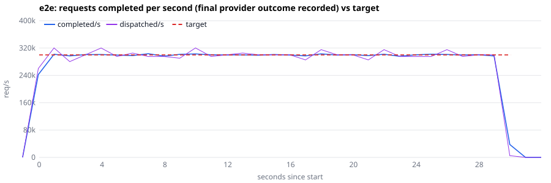

# Benchmark: end-to-end (HTTP -> gateway -> TCP -> provider simulator) @ 300,000 req/s target

Generated 2026-11-11T20:05:49.408Z by `node scenarios/bench.js --mode e2e --rate 300000 --duration 30 --gateway-shards 4 --provider-shards 4 --loadgen-workers 4`

## Measured
| metric | value |
| --- | --- |
| target submit rate (req/s) | 300,000 |
| achieved submit rate (req/s) | 299,293 |
| steady completion rate, mean (req/s) | **300,096** |
| steady completion rate, median / min 1 s (req/s) | 300,180 / 295,904 |
| peak 1 s completions | 303,464 |
| steady window (s) | 24 |
| submitted | 8,980,000 |
| accepted / rejected | 8,980,000 / 0 |
| completed (succeeded + failed) | 8,980,000 (8,975,473 + 4,527) |
| expired / still waiting | 0 / 0 |
| accounting balanced | yes |
| retry attempts | 8,867 |
| end-to-end latency p50 / p95 / p99 (ms) | 70.66 / 219.14 / 356.35 |
| provider round trip p50 / p95 / p99 (ms) | 70.66 / 215.04 / 348.16 |
| API ack latency p50 / p99 (ms) | 7.49 / 25.86 |

## Configuration
| setting | value |
| --- | --- |
| rate | 300000 |
| durationS | 30 |
| batchSize | 5000 |
| tokens | 500 |
| payloadBytes | 32 |
| provider_shards | 4 |
| gateway_shards | 4 |
| loadgen_workers | 4 |

Simulated models: model-a (latency p50 50 ms / p99 250 ms), model-b (p50 80 ms / p99 400 ms), 0.1% transient + 0.05% permanent errors, limits raised to 60B RPM so they do not bind. Traffic split 50/50.

## Environment
| environment | value |
| --- | --- |
| node | v24.15.0 |
| platform | Windows_NT 10.0.26200 (win32/x64) |
| cpu | 12th Gen Intel(R) Core(TM) i5-12500H |
| logical_cpus | 16 |
| memory_gb | 15.6 |

