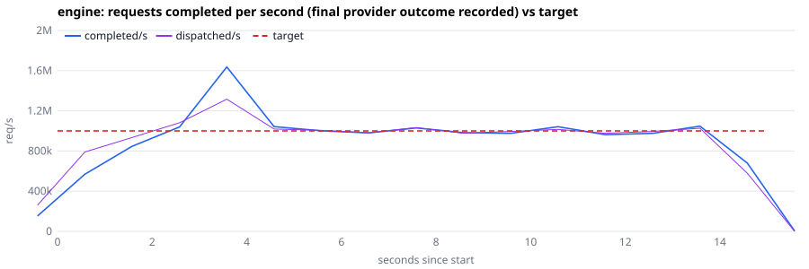

# Benchmark: engine + simulator in-process @ 1,000,000 req/s target

Generated 2026-11-11T19:51:13.961Z by `node scenarios/bench.js --mode engine --rate 1000000 --duration 15 --shards 14`

## Measured
| metric | value |
| --- | --- |
| target submit rate (req/s) | 1,000,000 |
| achieved submit rate (req/s) | 968,995 |
| steady completion rate, mean (req/s) | **1,072,825** |
| steady completion rate, median / min 1 s (req/s) | 1,001,264 / 962,922 |
| peak 1 s completions | 1,636,611 |
| steady window (s) | 9 |
| submitted | 14,970,000 |
| accepted / rejected | 14,970,000 / 0 |
| completed (succeeded + failed) | 14,970,000 (14,962,337 + 7,663) |
| expired / still waiting | 0 / 0 |
| accounting balanced | yes |
| retry attempts | 15,045 |
| end-to-end latency p50 / p95 / p99 (ms) | 130.05 / 712.7 / 1007.62 |
| provider round trip p50 / p95 / p99 (ms) | 111.62 / 548.86 / 778.24 |

## Configuration
| setting | value |
| --- | --- |
| rate | 1000000 |
| durationS | 15 |
| batchSize | 2000 |
| tokens | 500 |
| payloadBytes | 32 |
| shards | 14 |

Simulated models: model-a (latency p50 50 ms / p99 250 ms), model-b (p50 80 ms / p99 400 ms), 0.1% transient + 0.05% permanent errors, limits raised to 60B RPM so they do not bind. Traffic split 50/50.

## Environment
| environment | value |
| --- | --- |
| node | v24.15.0 |
| platform | Windows_NT 10.0.26200 (win32/x64) |
| cpu | 12th Gen Intel(R) Core(TM) i5-12500H |
| logical_cpus | 16 |
| memory_gb | 15.6 |

