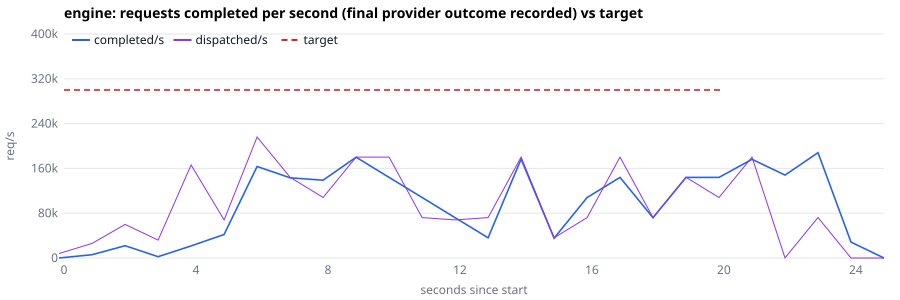

# Benchmark: engine + simulator in-process @ 300,000 req/s target

Generated 2026-11-11T20:08:54.123Z by `node scenarios/bench.js --mode engine --rate 300000 --duration 20 --shards 8`

## Measured
| metric | value |
| --- | --- |
| target submit rate (req/s) | 300,000 |
| achieved submit rate (req/s) | 105,005 |
| steady completion rate, mean (req/s) | **110,183** |
| steady completion rate, median / min 1 s (req/s) | 138,991 / 21,596 |
| peak 1 s completions | 188,074 |
| steady window (s) | 17 |
| submitted | 2,444,000 |
| accepted / rejected | 2,444,000 / 0 |
| completed (succeeded + failed) | 2,444,000 (2,442,715 + 1,285) |
| expired / still waiting | 0 / 0 |
| accounting balanced | yes |
| retry attempts | 2,411 |
| end-to-end latency p50 / p95 / p99 (ms) | 2785.28 / 6356.99 / 7405.57 |
| provider round trip p50 / p95 / p99 (ms) | 2129.92 / 5439.49 / 6094.85 |

## Configuration
| setting | value |
| --- | --- |
| rate | 300000 |
| durationS | 20 |
| batchSize | 2000 |
| tokens | 500 |
| payloadBytes | 32 |
| shards | 8 |

Simulated models: model-a (latency p50 50 ms / p99 250 ms), model-b (p50 80 ms / p99 400 ms), 0.1% transient + 0.05% permanent errors, limits raised to 60B RPM so they do not bind. Traffic split 50/50.

## Environment
| environment | value |
| --- | --- |
| node | v24.15.0 |
| platform | Windows_NT 10.0.26200 (win32/x64) |
| cpu | 12th Gen Intel(R) Core(TM) i5-12500H |
| logical_cpus | 16 |
| memory_gb | 15.6 |

