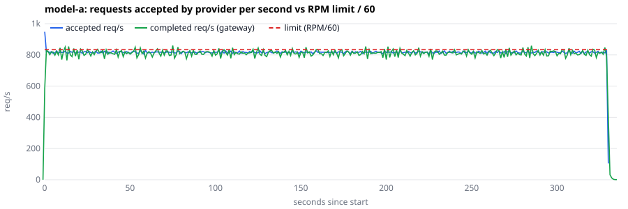
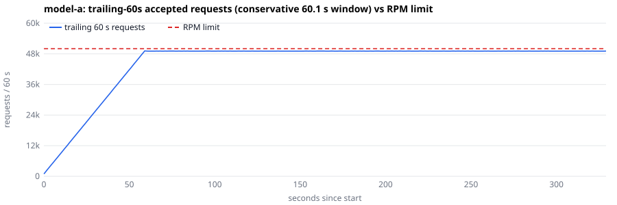
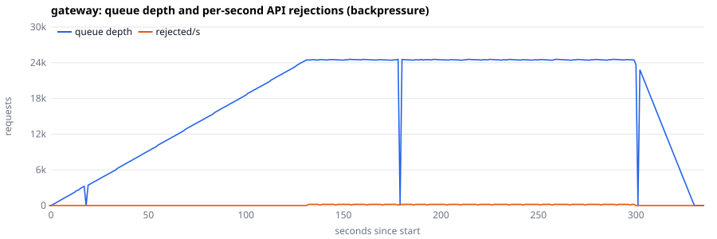

# Scenario 1: reach the available provider capacity: PASS

Generated 2026-11-11T19:58:37.380Z by `node scenarios/scenario1.js`

Setup: one model (model-a) at **50,000 RPM / 100,000,000 TPM**. Load generator submits 1,000-token requests at **1,000 req/s** (120% of the RPM limit) in batches of 100 for **300 s**. Gateway: 1 engine shard, pacing at 98% of the limit plus a strict trailing-60 s guard, admission control at 30 s estimated queue wait, request TTL 120 s. Simulated provider: lognormal latency p50 300 ms / p99 2 s, 0.5% transient errors, 0.1% permanent errors.

## Checks
| check | result | measured |
| --- | --- | --- |
| completes >= 90% of allowed capacity after 60s warm-up | PASS | 812.7 completions/s vs 833.3 allowed/s = 97.52% |
| no 60 s period exceeds 50,000 requests | PASS | max trailing-60s requests at provider = 49,218 |
| no 60 s period exceeds 100M tokens | PASS | max trailing-60s tokens at provider = 49,218,000 |
| every submitted request accounted for | PASS | 299,900 = 268,400 completed + 0 waiting + 0 expired + 31,500 rejected (+0 errors) |

Drain after submission: completed in 35.3 s.

## Results
### Requests
| submitted | accepted | rejected (429 at API) | client errors | completed | succeeded | failed | expired | waiting at end |
| --- | --- | --- | --- | --- | --- | --- | --- | --- |
| 299,900 | 268,400 | 31,500 | 0 | 268,400 | 268,127 | 273 | 0 | 0 |

Accounting: submitted 299,900 = completed 268,400 + expired 0 + rejected 31,500 + waiting 0 + client errors 0 -> balanced. Waiting when submission stopped: 24,804. Retry attempts: 1,346. Provider 429s: 0.

### Throughput
| target submit rate (req/s) | achieved submit rate | completion rate after 60s warm-up (req/s) | completion rate overall (req/s) |
| --- | --- | --- | --- |
| 1,000 | 1,000 | 813 | 799 |

### Latency (ms)
| measure | count | p50 | p95 | p99 | max |
| --- | --- | --- | --- | --- | --- |
| end-to-end (accepted -> final, incl. queueing) | 268,400 | 30146.56 | 31195.14 | 31719.42 | 40152 |
| provider round trip (final attempt) | 268,400 | 307.2 | 1163.26 | 2015.23 | 11206 |
| API acknowledgement (client side) | 2,999 | 1.07 | 2.14 | 3.49 | 35.65 |

### Limits: configured vs observed (observed = calls the provider simulator accepted)
| model | RPM limit (end) | observed RPM (steady) | max trailing-60s requests | TPM limit (end) | observed TPM (steady) | max trailing-60s tokens | worst trailing-60s / limit (req / tok) | windows over limit | provider 429s |
| --- | --- | --- | --- | --- | --- | --- | --- | --- | --- |
| model-a | 50,000 | 48,999 | 49,218 | 100,000,000 | 48,999,250 | 49,218,000 | 98.44% / 49.22% | 0 | 0 |

### Batches and callbacks
| batches accepted | rejected | completed | completion p50 / p95 / p99 (ms) | callbacks delivered / failed / attempts | complete -> delivered p50 / p99 (ms) |
| --- | --- | --- | --- | --- | --- |
| 2,684 | 315 | 2,684 | 31719.42 / 34078.72 / 35127.3 | 0 / 0 / 0 | null / null |

## Environment
| environment | value |
| --- | --- |
| node | v24.15.0 |
| platform | Windows_NT 10.0.26200 (win32/x64) |
| cpu | 12th Gen Intel(R) Core(TM) i5-12500H |
| logical_cpus | 16 |
| memory_gb | 15.6 |

