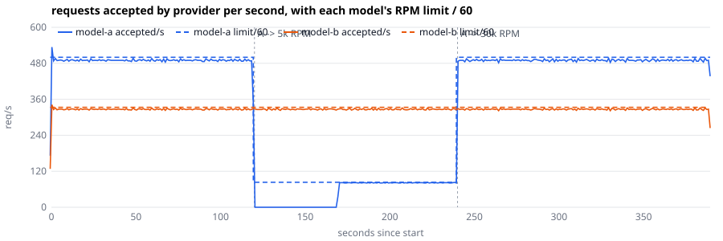
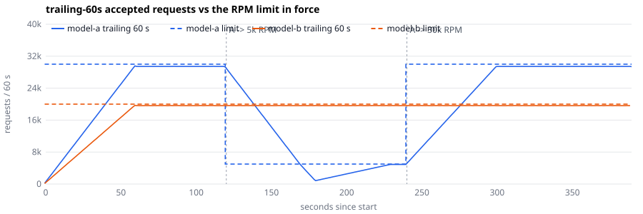
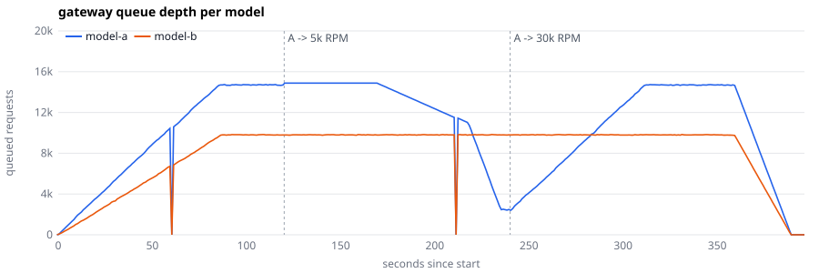

# Scenario 2: different models and changing limits: PASS

Generated 2026-11-11T20:05:16.096Z by `node scenarios/scenario2.js`

Setup: model-a 30,000 RPM / 60,000,000 TPM, model-b 20,000 RPM / 40,000,000 TPM. Load: 1,100 req/s of 1,000-token requests, mix model-a 0.6, model-b 0.4 (both models above their limits). At t=120s the provider lowers model-a to 5,000 RPM; at t=240s it restores 30,000 RPM. The gateway is not restarted: it polls the provider's limits every second and re-reads them immediately when it sees a 429.

Limit semantics: a request is admitted only if the trailing 60 s (including it) stays within the limit **in force at that moment**. So after model-a drops to 5,000 RPM, it pauses until its trailing-minute usage (~30,000) ages below 5,000, then runs at ~5,000 RPM. Restoring the limit takes effect immediately.

## Checks
| check | result | measured |
| --- | --- | --- |
| model-a within its current limit at all times | PASS | worst trailing-60s / limit-in-force = 98.57% (req), 49.29% (tok); 0 buckets over |
| model-b within its current limit at all times | PASS | worst trailing-60s / limit = 98.57% (req), 49.29% (tok); 0 buckets over |
| model-a adjusts to the reduction without restart | PASS | gateway applied 5000 RPM 452 ms after the provider change; steady rate once the 60 s window drained = 4,900 RPM (limit 5,000) |
| model-a adjusts to the restore without restart | PASS | gateway applied 30000 RPM 303 ms after the change; rate after restore = 29,399 RPM; gateway pid 7540 -> 7540 |
| model-b keeps processing while model-a is constrained | PASS | model-b 19,600 RPM before, 19,600 RPM during, 19,600 RPM after (limit 20,000) |

## Configured limit and observed throughput over time (10 s steps, provider-side)
| t (s) | A limit RPM | A observed RPM (10 s avg x 60) | A trailing 60 s | B limit RPM | B observed RPM | B trailing 60 s |
| --- | --- | --- | --- | --- | --- | --- |
| -9 | 30,000 | 4,236 | 172 | 20,000 | 2,820 | 128 |
| 1 | 30,000 | 29,406 | 1,194 | 20,000 | 19,608 | 796 |
| 11 | 30,000 | 29,412 | 6,098 | 20,000 | 19,608 | 4,065 |
| 21 | 30,000 | 29,406 | 11,000 | 20,000 | 19,602 | 7,333 |
| 31 | 30,000 | 29,400 | 15,900 | 20,000 | 19,602 | 10,600 |
| 41 | 30,000 | 29,364 | 20,800 | 20,000 | 19,572 | 13,866 |
| 51 | 30,000 | 29,436 | 25,695 | 20,000 | 19,626 | 17,130 |
| 61 | 30,000 | 29,388 | 29,452 | 20,000 | 19,590 | 19,635 |
| 71 | 30,000 | 29,412 | 29,449 | 20,000 | 19,608 | 19,633 |
| 81 | 30,000 | 29,358 | 29,449 | 20,000 | 19,578 | 19,633 |
| 91 | 30,000 | 29,430 | 29,448 | 20,000 | 19,620 | 19,631 |
| 101 | 30,000 | 29,400 | 29,449 | 20,000 | 19,596 | 19,632 |
| 111 | 30,000 | 25,590 | 29,457 | 20,000 | 19,614 | 19,638 |
| 121 | 5,000 | 0 | 28,323 | 20,000 | 19,578 | 19,634 |
| 131 | 5,000 | 0 | 23,423 | 20,000 | 19,620 | 19,632 |
| 141 | 5,000 | 0 | 18,522 | 20,000 | 19,584 | 19,631 |
| 151 | 5,000 | 0 | 13,625 | 20,000 | 19,590 | 19,633 |
| 161 | 5,000 | 702 | 8,726 | 20,000 | 19,614 | 19,634 |
| 171 | 5,000 | 4,902 | 4,022 | 20,000 | 19,608 | 19,634 |
| 181 | 5,000 | 4,896 | 1,015 | 20,000 | 19,584 | 19,632 |
| 191 | 5,000 | 4,902 | 1,832 | 20,000 | 19,620 | 19,636 |
| 201 | 5,000 | 4,896 | 2,648 | 20,000 | 19,578 | 19,633 |
| 211 | 5,000 | 4,902 | 3,465 | 20,000 | 19,614 | 19,631 |
| 221 | 5,000 | 4,902 | 4,281 | 20,000 | 19,596 | 19,628 |
| 231 | 5,000 | 7,332 | 4,908 | 20,000 | 19,614 | 19,631 |
| 241 | 30,000 | 29,376 | 5,722 | 20,000 | 19,584 | 19,633 |
| 251 | 30,000 | 29,406 | 9,805 | 20,000 | 19,608 | 19,636 |
| 261 | 30,000 | 29,406 | 13,886 | 20,000 | 19,602 | 19,632 |
| 271 | 30,000 | 29,412 | 17,970 | 20,000 | 19,608 | 19,632 |
| 281 | 30,000 | 29,370 | 22,054 | 20,000 | 19,578 | 19,634 |
| 291 | 30,000 | 29,406 | 26,138 | 20,000 | 19,602 | 19,633 |
| 301 | 30,000 | 29,370 | 29,444 | 20,000 | 19,584 | 19,629 |
| 311 | 30,000 | 29,442 | 29,452 | 20,000 | 19,626 | 19,634 |
| 321 | 30,000 | 29,370 | 29,446 | 20,000 | 19,578 | 19,631 |
| 331 | 30,000 | 29,442 | 29,448 | 20,000 | 19,632 | 19,632 |
| 341 | 30,000 | 29,370 | 29,450 | 20,000 | 19,578 | 19,633 |
| 351 | 30,000 | 29,406 | 29,447 | 20,000 | 19,602 | 19,632 |

Limit changes seen by the gateway: 19:58:38.529 model-a 30,000 RPM (startup); 20:00:39.151 model-a 5,000 RPM (provider:poll); 20:02:39.008 model-a 30,000 RPM (provider:poll)

Drain after submission: completed in 37.3 s.

## Results
### Requests
| submitted | accepted | rejected (429 at API) | client errors | completed | succeeded | failed | expired | waiting at end |
| --- | --- | --- | --- | --- | --- | --- | --- | --- |
| 395,900 | 273,364 | 122,536 | 0 | 264,231 | 263,964 | 267 | 9,133 | 0 |

Accounting: submitted 395,900 = completed 264,231 + expired 9,133 + rejected 122,536 + waiting 0 + client errors 0 -> balanced. Waiting when submission stopped: 24,891. Retry attempts: 1,321. Provider 429s: 131.

### Throughput
| target submit rate (req/s) | achieved submit rate | completion rate after 0s warm-up (req/s) | completion rate overall (req/s) |
| --- | --- | --- | --- |
| 1,100 | 1,100 | 665 | 664 |

### Latency (ms)
| measure | count | p50 | p95 | p99 | max |
| --- | --- | --- | --- | --- | --- |
| end-to-end (accepted -> final, incl. queueing) | 264,231 | 28049.41 | 31719.42 | 112197.63 | 125672 |
| provider round trip (final attempt) | 264,231 | 389.12 | 1490.94 | 2588.67 | 15282 |
| API acknowledgement (client side) | 3,959 | 0.94 | 1.55 | 2.08 | 28.12 |

### Limits: configured vs observed (observed = calls the provider simulator accepted)
| model | RPM limit (end) | observed RPM (steady) | max trailing-60s requests | TPM limit (end) | observed TPM (steady) | max trailing-60s tokens | worst trailing-60s / limit (req / tok) | windows over limit | provider 429s |
| --- | --- | --- | --- | --- | --- | --- | --- | --- | --- |
| model-a | 30,000 | 20,541 | 29,571 | 60,000,000 | 20,541,000 | 29,571,000 | 98.57% / 49.29% | 0 | 131 |
| model-b | 20,000 | 19,603 | 19,714 | 40,000,000 | 19,602,833 | 19,714,000 | 98.57% / 49.29% | 0 | 0 |

### Batches and callbacks
| batches accepted | rejected | completed | completion p50 / p95 / p99 (ms) | callbacks delivered / failed / attempts | complete -> delivered p50 / p99 (ms) |
| --- | --- | --- | --- | --- | --- |
| 3,569 | 390 | 3,569 | 32243.71 / 120586.24 / 122683.39 | 0 / 0 / 0 | null / null |

## Environment
| environment | value |
| --- | --- |
| node | v24.15.0 |
| platform | Windows_NT 10.0.26200 (win32/x64) |
| cpu | 12th Gen Intel(R) Core(TM) i5-12500H |
| logical_cpus | 16 |
| memory_gb | 15.6 |

