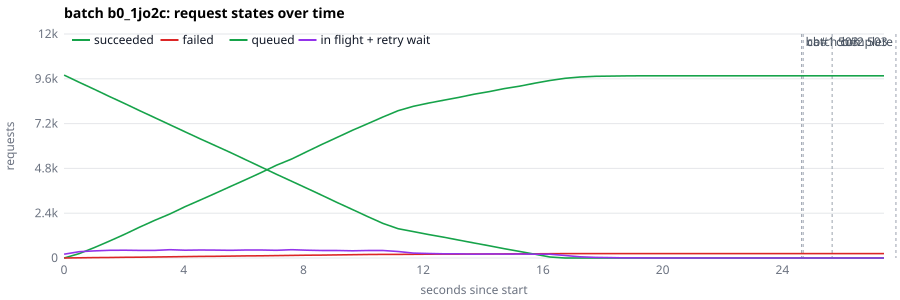
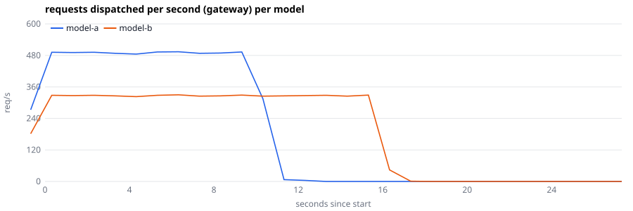

# Scenario 3: asynchronous batch completion: PASS

Generated 2026-11-11T19:53:00.970Z by `node scenarios/scenario3.js`

Setup: one batch of 10,000 requests (half model-a at 30,000 RPM, half model-b at 20,000 RPM, 500-1,500 tokens each) with a callback_url. The simulated provider returns 8% transient errors, 1% timeouts (after 2 s) and 2% permanent errors per call. Transient errors and timeouts are retried (up to 4 attempts, exponential backoff); permanent errors fail at once. The callback receiver answers 503 to the first 2 delivery attempts, then 200. Callback retry backoff: 1 s, 2 s, 4 s, ... (+/-20% jitter).

## Checks
| check | result | measured |
| --- | --- | --- |
| acknowledgement returned within 1 s | PASS | HTTP 202 in 30.7 ms (batch b0_1jo2c, 10,000 requests, 1,143,986 bytes) |
| callback sent only after all requests are final | PASS | batch completed 2026-11-11T19:52:57.321Z; first attempt 2026-11-11T19:52:57.373Z (+52 ms); waiting at first attempt = 0; 9762 + 238 = 10000 |
| callback delivered after the destination recovers | PASS | attempts: #1@+0.05s->503, #2@+1.02s->503, #3@+3.15s->200; gateway callback state = delivered |
| callback summary matches GET /v1/batches/:id | PASS | identical on batch_id, status, total, succeeded, failed, waiting, completed_at, created_at, duration_ms, counts, failure_breakdown |
| every request id appears exactly once in the final result | PASS | results API: 10000 rows, 0 dup, 0 missing, 0 non-final; callback inline: 10000 rows, 0 dup, 0 missing |

## Batch outcome
| status | total | succeeded | failed (provider/retries) | expired | batch duration (ms) | complete -> delivered (ms) |
| --- | --- | --- | --- | --- | --- | --- |
| completed_with_failures | 10,000 | 9,762 | 238 | 0 | 24,651 | 3,152 |

Final state per request:
| final state | requests |
| --- | --- |
| failed (provider_permanent_error) | 238 |
| succeeded | 9,762 |

Provider attempts per request:
| attempts | requests |
| --- | --- |
| 1 | 9,120 |
| 2 | 803 |
| 3 | 73 |
| 4 | 4 |

## Callback delivery attempts (as seen by the receiver)
| # | X-Callback-Attempt | Idempotency-Key | received (+ms after completion) | receiver answered | batch waiting at arrival |
| --- | --- | --- | --- | --- | --- |
| 1 | 1 | b0_1jo2c | 2026-11-11T19:52:57.373Z (+52) | 503 | 0 |
| 2 | 2 | b0_1jo2c | 2026-11-11T19:52:58.341Z (+1020) | 503 | 0 |
| 3 | 3 | b0_1jo2c | 2026-11-11T19:53:00.473Z (+3152) | 200 | 0 |

Delivered callback body (results truncated):
```json
{
  "event": "batch.completed",
  "batch_id": "b0_1jo2c",
  "status": "completed_with_failures",
  "total": 10000,
  "succeeded": 9762,
  "failed": 238,
  "failure_breakdown": {
    "provider_or_retries": 238,
    "expired": 0,
    "rejected_at_admission": 0
  },
  "waiting": 0,
  "counts": {
    "queued": 0,
    "in_flight": 0,
    "retry_wait": 0,
    "succeeded": 9762,
    "failed": 238,
    "expired": 0,
    "rejected": 0
  },
  "created_at": "2026-11-11T19:52:32.670Z",
  "completed_at": "2026-11-11T19:52:57.321Z",
  "duration_ms": 24651,
  "deadline_at": "2026-11-11T19:54:32.670Z",
  "metadata": {
    "scenario": 3
  },
  "results_url": "http://127.0.0.1:8000/v1/batches/b0_1jo2c/results",
  "results": [
    {
      "request_id": "s3-00000",
      "model": "model-a",
      "status": "succeeded",
      "attempts": 1,
      "estimated_tokens": 1220,
      "latency_ms": 351,
      "output_tokens": 305,
      "error": null
    },
    {
      "request_id": "s3-00001",
      "model": "model-b",
      "status": "succeeded",
      "attempts": 1,
      "estimated_tokens": 538,
      "latency_ms": 218,
      "output_tokens": 135,
      "error": null
    },
    {
      "request_id": "s3-00002",
      "model": "model-a",
      "status": "succeeded",
      "attempts": 1,
      "estimated_tokens": 956,
      "latency_ms": 218,
      "output_tokens": 239,
      "error": null
    },
    "... 9997 more"
  ]
}
```

## Environment
| environment | value |
| --- | --- |
| node | v24.15.0 |
| platform | Windows_NT 10.0.26200 (win32/x64) |
| cpu | 12th Gen Intel(R) Core(TM) i5-12500H |
| logical_cpus | 16 |
| memory_gb | 15.6 |




